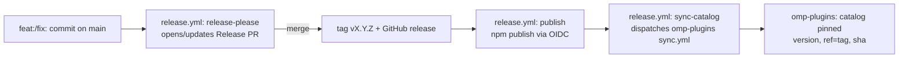

# Releasing

Releases are automated. The only manual step is merging the release-please PR.



## Pieces

| Piece | Where | Notes |
| --- | --- | --- |
| Type check | `.github/workflows/ci.yml` | PRs and pushes to `main`: `pnpm install --frozen-lockfile --ignore-scripts`, `pnpm run check` (`tsc -p .`) |
| Release PR | `release.yml` job `release-please` | Config `release-please-config.json` (single package `.`, release-type `node`, tags `vX.Y.Z`); version state `.release-please-manifest.json` |
| npm publish | `release.yml` job `publish` | Runs only when `release_created == 'true'`. Installs with pnpm, publishes with `npm publish --provenance --access public` (npm CLI upgraded to latest; OIDC needs ≥ 11.5.1) |
| Catalog sync | `release.yml` job `sync-catalog` | `gh workflow run sync.yml --repo ryok90/omp-plugins` with secret `OMP_PLUGINS_DISPATCH_TOKEN` |
| Catalog | `ryok90/omp-plugins` → `.omp-plugin/marketplace.json`, `.github/workflows/sync.yml` | `workflow_dispatch` only. For each `source.source == "github"` plugin: latest GitHub release → `version`, `source.ref`, `source.sha`; commits with its own `GITHUB_TOKEN` |

External configuration (not in git):

- **npm trusted publisher** for `omp-pr-tracker`: GitHub Actions, `ryok90` / `omp-pr-tracker` / workflow `release.yml`, no environment. Renaming `release.yml` or moving `npm publish` to another workflow breaks publishing.
- **Repo secret** `OMP_PLUGINS_DISPATCH_TOKEN`: fine-grained PAT, repository `ryok90/omp-plugins` only, Actions: read and write. It expires.
- **Repo Actions setting**: "Allow GitHub Actions to create and approve pull requests" is on (release-please needs it).

## Rules that matter

- Only `feat:` (minor), `fix:` (patch) and `!`/`BREAKING CHANGE` (major) cut a release. `ci:`, `build:`, `docs:`, `chore:` don't; untyped commits are ignored ("commit could not be parsed").
- Force a version: an empty commit with footer `Release-As: 1.2.3`.
- `publish` lives in the same workflow as release-please on purpose: a release created with `GITHUB_TOKEN` doesn't trigger other workflows.
- The catalog pins tags, so marketplace installs only see released code; `omp plugin upgrade` compares the catalog `version`.

## Checking a release

```sh
gh run list --repo ryok90/omp-pr-tracker --workflow release.yml --limit 3
npm view omp-pr-tracker version
gh run list --repo ryok90/omp-plugins --workflow sync.yml --limit 3
gh api repos/ryok90/omp-plugins/contents/.omp-plugin/marketplace.json --jq .content | base64 -d | jq '.plugins[] | {name, version, source}'
```

## Troubleshooting

| Symptom | Likely cause | Fix |
| --- | --- | --- |
| No Release PR after merging | No `feat:`/`fix:` commit since the last tag (log: "No user facing commits found") | Expected; or `Release-As:` footer |
| release-please fails creating the PR | Actions PR permission turned off | `gh api -X PUT repos/ryok90/omp-pr-tracker/actions/permissions/workflow -f default_workflow_permissions=read -F can_approve_pull_request_reviews=true` |
| `publish` 404 / `ENEEDAUTH` / OIDC error | Trusted publisher mismatch (repo, filename, environment) or npm < 11.5.1 | Fix the npm package settings; keep the `npm install -g npm@latest` step |
| npm shows only a stub / version needs approval | npm staged publishing enabled | Approve the staged version on npmjs.com |
| `pnpm install --frozen-lockfile` fails | Lockfile out of date with `package.json` | `pnpm install` locally, commit `pnpm-lock.yaml` |
| `sync-catalog` 403/404 | Token expired, or missing repo access / Actions permission | New fine-grained PAT; `gh secret set OMP_PLUGINS_DISPATCH_TOKEN --repo ryok90/omp-pr-tracker` |
| Catalog stale but release fine | `sync-catalog` failed or skipped | `gh workflow run sync.yml --repo ryok90/omp-plugins` |
| `sync.yml` push rejected | Concurrent commit to `omp-plugins` main | Re-run the workflow |
| Release published, tag wrong | Manifest/config edited by hand | Fix `.release-please-manifest.json` to the last released version |
